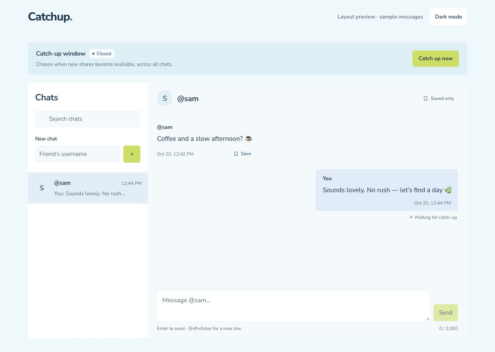
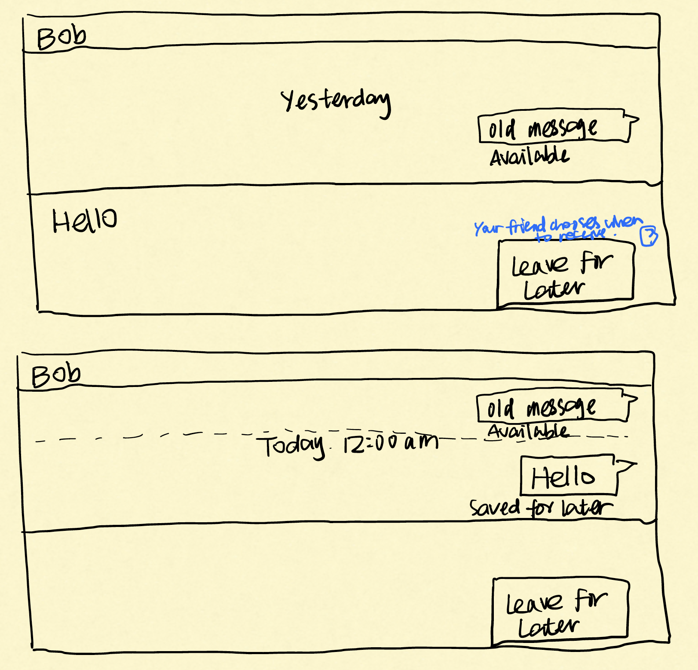
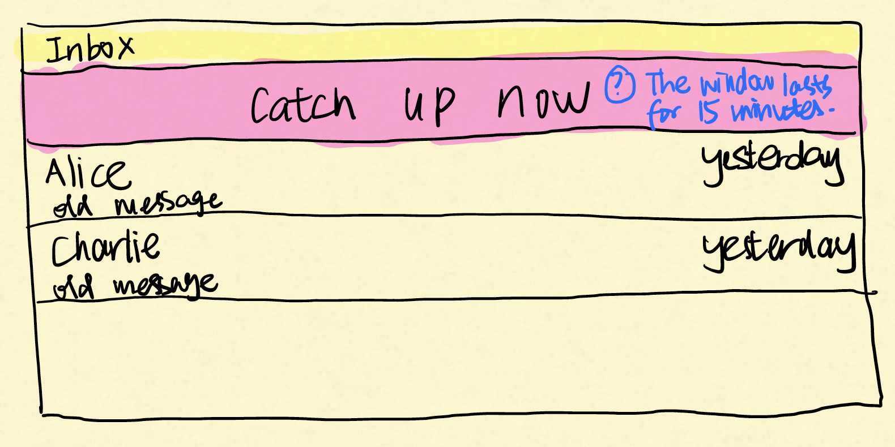
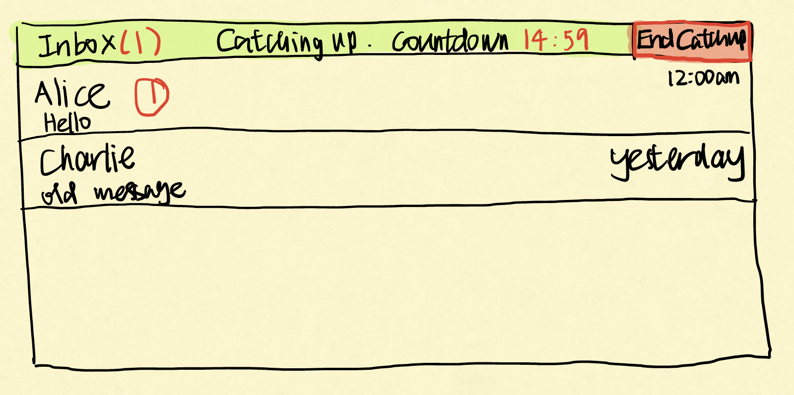
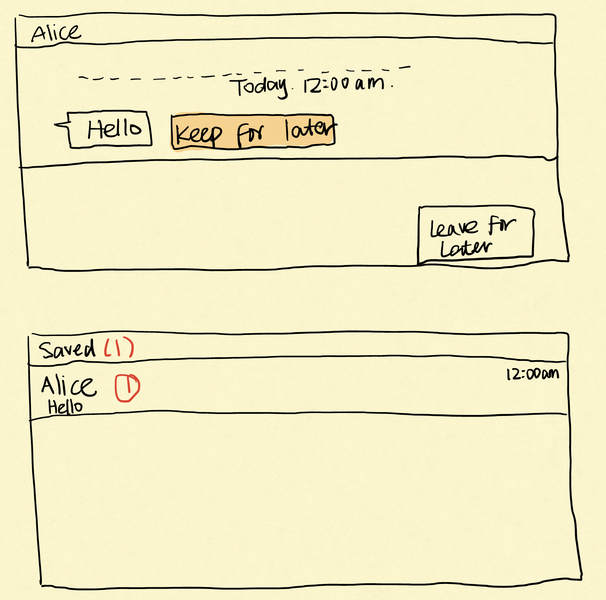

# Catchup

**Share when you think of it. Catch up when you choose.**

MIT 6.1040 · Fall 2026 · Personal Project · [P1: Design](https://61040.github.io/fa26/assignments/personal-project/#p1-design) · [P2: MVP](https://61040.github.io/fa26/assignments/p2/) · [P3: Beta](https://61040.github.io/fa26/assignments/p3/)

Catchup is a private space for existing friends to exchange non-urgent messages, links, and handwritten drawings. A friend can share something when they think of it; the recipient chooses when new shares enter their conversation history by opening a 15-minute catch-up window. Pending incoming messages stay hidden, and previously released conversations remain accessible. The proposed benefit is helping friends return to exchanges they value at a welcome moment. Whether this helps enough to justify another app remains to be tested.

## P3 deliverables

- [Updated user journey](user_journey.md)
- [demo](https://youtu.be/V-WbEcGa3fw)
- [Visual design study](visual_design_study.pptx)
- [catch-up.mit-sdg.dev](https://catch-up.mit-sdg.dev/)
- [P3 automated validation results](docs/validation/README.md) — 89 passing tests, including 45 drawing tests, with saved output and limits
- [Design notebook in the individual repository](https://github.com/niheyang/6.1040/blob/main/design_notes.md)

## Contents

- [Run the P2 implementation](#run-the-p2-implementation)
- [Try the core journey](#try-the-core-journey)
- [MVP scope](#mvp-scope)
- [Understand the implementation](#understand-the-implementation)
- [Validation and project progress](#validation-and-project-progress)
- [Problem framing and stakeholders](#problem-framing-and-stakeholders)
- [Application pitch](#application-pitch)
- [Concept design](#concept-design)
- [UI sketches](#ui-sketches)
- [User journey](#user-journey)
- [Evaluation plan](#evaluation-plan)

## Run the P2 implementation

The local app uses **Vue** for the browser interface, **Bun and sync-engine 1.1.0** for the backend, and **MongoDB** for persistent data. A terminal is where you enter the commands below. Keep the terminal running while using the app.

Prerequisites are Bun and a running Podman machine with a Compose provider, following the [course MongoDB setup guide](https://61040.github.io/fa26/resources/mongodb-setup/). This computer already has these dependencies and the project's local configuration installed.

From Terminal:

```sh
cd /Users/heyangni/Desktop/6.1040/61040project
bun run dev
```

Open **[Catchup at http://127.0.0.1:8080](http://127.0.0.1:8080)**. The command first starts MongoDB and waits for a successful connection, then runs the backend and frontend together. If Podman reports that its machine is stopped, run `podman machine start`, then retry `bun run dev`.

For a fresh checkout, run these once from the project folder before starting:

```sh
bun install
cp .env.example .env
bun run dev
```

Copy the example only when `.env` does not already exist. It configures the local database connection. The `.env` file is ignored by Git.

| Component | Address / location | What it does |
| --- | --- | --- |
| Vue frontend | `http://127.0.0.1:8080` | Friend conversations, messages, and catch-up controls |
| Bun backend | `http://127.0.0.1:3000` | Authentication, authorized requests, and reactions |
| MongoDB | `127.0.0.1:27018`, database `catchup` | Accounts, messages, delivery state, windows, and bookmarks |

The frontend forwards `/api` requests to the backend. MongoDB uses port 27018 so it can run alongside the earlier practice database on port 27017. Its named container volume preserves data between restarts.

Press **Control-C** in the terminal to stop the development servers. `bun run db:down` stops MongoDB while retaining its data volume. To check the connection separately, use `bun run db:check`. `bun run db:logs` shows database startup logs.

## Try the core journey

Use two browser tabs or windows and create two accounts, such as Alice and Bob. Usernames use 3–24 letters, numbers, or underscores and ignore case. Passwords use 8–128 characters. Exchange usernames to send shares.

For trying this computer's existing sample data, the local demo accounts are `alice_demo` and `bob_demo`, both with password `catchup-demo-2026`. Bob has received three sample shares and saved one. These accounts are demonstration fixtures.

1. **Alice starts a chat.** Enter Bob's exact username in **Find or start a chat** and select the plus button or press Enter. Send a short message or link using **Text**, or select **Draw** to send a handwritten note. Alice's outgoing message shows **Waiting for catch-up** while Bob's reception is closed.
2. **Bob signs in.** Held messages reveal no conversation row, preview, badge, or waiting count. Signing in or opening an existing chat does not open reception.
3. **Bob selects Catch up now.** A 15-minute window opens across all friends. Alice's message appears in their conversation with its original creation time.
4. **Alice sends another share.** During Bob's open window, it becomes **Available** and appears automatically. Available describes access; it is not a read receipt.
5. **Bob replies in Alice's chat.** Both directions appear together in chronological order. His reply waits for Alice's own catch-up window. He can select **Save** on a received message and use **Saved only** to find his private bookmarks within that chat.
6. **Bob ends catch-up.** Released messages and bookmarks remain accessible. Another new share from Alice waits until Bob opens a later window.
7. **Bob removes a bookmark.** Select **Saved** on the bookmarked bubble. It disappears from the saved filter while its original message remains in the conversation.

You must sign in again after reloading because the Vue app keeps credentials only in memory. Accounts and content remain in MongoDB. An existing receiving window also persists: signing out or closing a tab does not end it. Use **End catch-up** or let its server-side deadline pass.

## MVP scope

This MVP demonstrates three product behaviors: capture a share, choose when to receive it, and keep a received message for later. The P3 interface groups the exchange into one conversation per friend, with incoming and outgoing bubbles, a targeted composer, conversation search, and a private saved-message filter.

Start a conversation by an existing friend's username. **Find or start a chat** filters existing conversations by username or typed message content, ignoring case. Clicking a result opens that conversation at its matching message. Enter or the plus button opens or starts a chat with the exact username, after checking the account exists. An optional leading `@` is accepted. A username mentioned in another conversation does not redirect the Enter action to that content match. Missing accounts produce an error without creating an empty chat. Drawings have a **[Drawing]** preview; their handwriting is not searched or recognized.

Conversations containing messages are reconstructed from MongoDB history when you sign in. Empty new chats and per-friend text/drawing drafts stay in memory for the current tab and clear on sign-out or reload. Friends do not require a separate request or acceptance step. Messages refresh automatically while the tab is visible; the interface adds no read receipts, presence indicators, or held-message counts.

### Handwriting and doodles

The composer defaults to **Text**. Select **Draw** for a small freehand pad with navy, teal, and coral ink, **Undo**, **Clear**, and **Send drawing**. Switching modes or friends preserves completed draft strokes during the current signed-in session; a successful send clears only the drawing that was sent. The same catch-up release rules and private bookmarks apply to both message formats.

The editor uses [Signature Pad](https://github.com/szimek/signature_pad), an MIT-licensed library, with our Vue controls and message integration. Its [license notice](web/public/third-party-notices.txt) is included with the app. Drawings are stored as bounded stroke coordinates in MongoDB, with no separate media upload service. The format has a 600×300 logical canvas, three allowed ink colors, and limits of 120 strokes, 3,000 points, and 96,000 serialized bytes. These bounds keep small notes suitable for the current full-history dashboard refresh. Larger media support would need a different loading strategy.

See the [handwriting implementation walkthrough](docs/handwriting.md) for the data flow and file locations. [Automated drawing validation](docs/validation/README.md) covers storage, refusals, release/privacy, bookmarks, serialization, and previews. Browser interaction, appearance, and live-deployment checks remain to be recorded separately.

## Understand the implementation

### Step 1: Connect a persistent database

[`compose.yaml`](compose.yaml) runs MongoDB locally, and [`src/db.ts`](src/db.ts) reads the connection address from `.env`. [`scripts/check-db.ts`](scripts/check-db.ts) sends a database ping. This confirms the app can store data before starting its web servers.

### Step 2: Give each concept its own state

The five independent concept implementations live in [`src/concepts/`](src/concepts/), with strict specifications in [`design/concepts/`](design/concepts/). Each receives a MongoDB database and owns separate collections. Concepts do not import or call one another.

| Concept | Responsibility |
| --- | --- |
| PasswordAuthenticating | Register accounts, store Argon2id password hashes, and return a stable authenticated user identity |
| Messaging | Preserve text or drawing content, sender, recipient, and original creation time |
| Holding | Keep opaque message handles pending or released; repeated enqueue/release is harmless |
| Receptivity | Manage explicit 15-minute receiving windows and safely replace or close them |
| Bookmarking | Keep a private, idempotent list of opaque message handles |

Unique database indexes prevent duplicate usernames, holding entries, and bookmarks. Receptivity checks the trusted server clock whenever readiness is queried; release stops at the deadline even if the cleanup timer runs late. Old close/expiry handles cannot end a replacement window.

### Step 3: Connect the concepts with reactions

[`src/compositions/Catchup.ts`](src/compositions/Catchup.ts) expresses the application rules in the course's sync-engine DSL:

- A message creation triggers enqueueing in Holding.
- Opening reception triggers release of pending items.
- Enqueueing during an open window triggers release of that item.
- A received message is returned only when it belongs to the authenticated recipient and has been released.
- Saving requires the same ownership and release checks.

Every protected endpoint authenticates its credentials. The acting identity comes from authentication, and request validation rejects additional fields such as a spoofed sender. Dashboard responses include authorized incoming messages, the user's own sent records, their private saved list, and their own active window. They include no pending incoming count or previews.

[`src/server.ts`](src/server.ts) serializes complete request flows in this local backend process and waits for reactions to finish. This prevents a close operation from slipping between a release's readiness check and its action. Multiple backend replicas would require shared coordination; the current MVP runs one backend process.

[`design/types.md`](design/types.md) binds opaque concept types; [`design/compositions/Catchup.md`](design/compositions/Catchup.md) explains the authored composition. [`src/assembly.ts`](src/assembly.ts) assembles the concepts and composition. [`generated/wire.ts`](generated/wire.ts) is generated from that assembly and describes the API's inputs and outputs. Regenerate it after changing the application contract with `bun run generate`.

### Step 4: Display the state with Vue

[`web/src/App.vue`](web/src/App.vue) contains the Composition API interface. [`web/src/conversations.ts`](web/src/conversations.ts) combines authorized incoming and outgoing records by friend, orders each thread chronologically, and derives its latest visible preview. [`web/src/ChatMessage.vue`](web/src/ChatMessage.vue) renders message bubbles, and [`web/src/api.ts`](web/src/api.ts) calls the typed generated API. Text and drawing messages use the generated backend contract; hidden incoming messages never reach the grouping or search code.

The P3 appearance update uses locally hosted [Nunito Sans](https://fontsource.org/fonts/nunito-sans), aqua surfaces, navy text, and yellow action buttons. The flatter chat layout uses 6-pixel button corners, fewer outlines, and 17-pixel message text. Received messages sit directly on the thread background; outgoing messages have a subtle fill and 8-pixel corners. Left/right alignment and distinct fills distinguish the two directions without repeating sender names above every message. The header's light/dark switch remembers the browser's choice and initially follows the device preference. Colors live in [`web/src/style.css`](web/src/style.css); theme behavior lives in [`web/src/theme.ts`](web/src/theme.ts). Sample-message layout previews from before the repeated sender labels were removed are available in [light mode](docs/previews/p3-flat-light.jpg), [dark mode](docs/previews/p3-flat-dark.jpg), and [mobile dark mode](docs/previews/p3-flat-mobile-dark.jpg).

`ref()` stores changing values such as the selected friend, per-friend drafts, and dashboard response. `computed()` derives the countdown, conversations, and saved-message lookup from those values. Stable message IDs used as Vue `:key` values keep rendered bubbles associated with the correct message. The dashboard refreshes every three seconds while the tab is visible; refreshing never starts a receiving window. Enter sends a message; Shift+Enter inserts a new line. On narrow screens, **Back to chats** returns to the friend list without losing the current draft.

### Step 5: Check the behavior

From the project folder:

```sh
bun run db:up
bun run check:design
bun run check
bun test
bun run build
```

`check:design` checks the authored specification format. `check` checks concept source, application diagnostics, generated artifacts, and backend/Vue types. `bun test` checks behavior using isolated temporary MongoDB databases; it does not clear the application's database. `build` produces frontend files in `web/dist` for later deployment work.

## Validation and project progress

On October 23, 2026, the complete automated suite passed **89 tests with 1,229 `expect()` calls**, including **45 drawing tests**. The authored design check, generated-artifact check, backend/Vue type checks, and production frontend build also passed. [Saved commands, results, initial correction, source hashes, and limitations](docs/validation/README.md) are included for P3. Database-backed tests use isolated temporary databases and do not clear the application's data.

The tests cover text and drawing persistence, password failures, recipient/release authorization, private bookmarks, malformed/spoofed requests, concurrent sending/opening/closing, exact expiry, stale window handles, and drawing format limits. Pure front-end data tests cover conversation grouping, username/content search, drawing previews, and drawing serialization. A local handler journey exercises the back end and MongoDB; it is not a substitute for completing the journey through the browser interface.

Earlier browser checks covered the text-only conversation flow and earlier typography/layout versions. The preview images below are historical. No browser checks were performed in the October 23 automated validation run; the latest handwriting controls, layout, themes, and deployed app still need manual verification.



The engine reports conservative endpoint-fallback and former-ordering advisories. Each endpoint binds authentication outputs, which its static fallback check does not prove; the tests exercise both successful requests and refusals. Array queries use deterministic database ordering, and Vue sorts the displayed messages explicitly. These advisories were reviewed rather than suppressed.

The concept discussion and UI sketches below record the earlier P1 design; the authored specifications linked above describe the implemented text and drawing behavior. The earlier P2 implementation used separate Inbox, Sent, and Saved views; its [screenshot](p2-preview.jpg) records that version. The current P3 interface combines friend histories and adds conversation search. Handwritten drawings are now implemented; voice, image uploads, and a first-use guide remain possible future work. Deployment preparation is documented separately from live deployment.

For a submission, record the current journey above with your own narration and add your own development/reflection notes. This README documents implementation and validation; it does not claim an observed user trial, deployment, or a completed personal reflection.

## Problem framing and stakeholders

### Domain

Casual, asynchronous communication between existing friends. People share small life updates, jokes, and interesting links to maintain their connection. These exchanges are not time-sensitive: the moment someone thinks of sharing something may differ from the moment their friend wants to read it. Receiving a message does not require an immediate reply or imply that both people are available for a live conversation.

### Bad situations

**Postponed sharing is forgotten.** Late at night, Alice finds a post she wants to send Bob. She is unsure whether sending it would disturb him, so she saves it and plans to send it tomorrow. The next day she forgets. A share she wanted to make never reaches her friend. Waiting avoids a possible interruption but leaves Alice responsible for remembering another task.

**An intention to revisit is lost.** Bob encounters a message while occupied and wants to return to it with more attention. Later, he forgets which exchange he intended to revisit. The desired follow-up is lost among other activity. This is a design hypothesis: the evidence below supports forgotten checking, but does not establish this entire sequence or how frequently it occurs.

The working question is whether a recipient-chosen receiving moment helps these friends return to wanted shares. The signal explored here is explicit readiness to receive new content. This is a hypothesis about timing and returning to an exchange, rather than a claim that the app can infer importance or guarantee attention.

The intended users are friends who experience these difficulties despite their existing arrangements. The problem is not universal. Someone comfortable sending at any hour, or whose scheduled sending, notification settings, and checking routines already meet their needs, may have little reason to use Catchup.

### Corroboration and its limits

In a [Reddit discussion of scheduled texting](https://www.reddit.com/r/NoStupidQuestions/comments/ss50c9/why_cant_you_schedule_texts_to_go_out_at_a_later/), the author describes saving posts instead of sending them at 2 a.m., then forgetting to share them. The author acknowledges Apple Shortcuts as a workaround. Other commenters describe being comfortable receiving messages at any hour or reluctant to adopt another messaging app. This historical account illustrates postponed sharing; it does not establish that scheduling is unavailable today or that Catchup is necessary.

In a [discussion of Do Not Disturb](https://www.reddit.com/r/ios/comments/mr2rzt/do_not_disturb/), a commenter reports forgetting to check missed notifications manually. This supports investigating forgotten checking. It does not establish that someone read a friend's message, intended a considered response, and then forgot that intention. The reported device behavior is historical, not a claim about current iOS.

No participant interviews or comparative trials have been recorded for this design. The second situation and the benefit of recipient-initiated catch-up need further evidence. Functional testing of the implementation does not establish that people benefit from this workflow.

### Workarounds and comparables

| Existing approach | What it already provides | Question remaining for Catchup |
|---|---|---|
| Wait to send | The sender avoids sending at an unwelcome moment. | Can immediate capture reduce the effort of remembering to share later? |
| [iMessage Send Later](https://support.apple.com/guide/iphone/schedule-a-text-message-to-send-later-iph5ae9a7be6/26/ios/26) | Scheduled delivery at a sender-selected time, up to 14 days ahead. | Is a recipient-selected receiving moment more useful than a scheduled time? |
| Muting, Focus, and [Scheduled Summary](https://support.apple.com/guide/iphone/change-notification-settings-iph7c3d96bab/ios) | Control over interruptions; selected notifications can be summarized at chosen times. | Does Catchup add enough value beyond checking an existing muted chat? |
| [Telegram Send When Online](https://telegram.org/blog/verifiable-apps-and-more) | Delivery when the recipient comes online, where their online status is visible to the sender. | Does explicitly choosing to catch up differ meaningfully from coming online? |
| [Apple message tracking](https://support.apple.com/guide/iphone/keep-track-of-messages-iphe9b48b89e/ios) and [Slack saved messages](https://slack.com/help/articles/360042650274-Save-messages-and-files-for-later) | Existing ways to preserve conversations or messages for later attention. | Does combining saved items with recipient-initiated receiving make returning easier? |

None of Catchup's individual components is claimed to be unprecedented. Existing chats also preserve messages, and muting, unread markers, summaries, and saved items can already help people manage later attention. Catchup's specific interaction keeps pending incoming content out of the recipient's conversation history until an explicit receiving window opens; browsing old exchanges does not admit new shares. The proposal combines this receiving boundary with friend conversations and private saved items. A notification plugin could address much of the original interruption problem and might implement similar behavior. Keeping pending items on a server is not, by itself, a reason to prefer this app.

Catchup would complement the friends' existing communication tools. One pair could try it without moving their wider social network. Nevertheless, an additional channel creates effort, and that cost must be evaluated.

### Stakeholders

- **Sender:** Wants to capture a share when they think of it, with confirmation that it has been saved and an understandable account of when it becomes available.
- **Recipient:** Wants control over when new shares appear and an easy way to retain messages they want to revisit.
- **People sharing the recipient's attention:** Classmates, colleagues, or companions may benefit if the recipient chooses an appropriate time to catch up. They do not interact with the app.

Sender and recipient are roles. Each participant occupies both roles at different times.

## Application pitch

### Catchup: Share when you think of it. Catch up when you choose.

Friends sometimes postpone a casual share or lose track of something they wanted to return to. Catchup gives an existing pair of friends a dedicated place to preserve those exchanges.

**Leave for later.** Write a short update or share a link as soon as it comes to mind. Catchup confirms that it has been saved for the recipient. The sender does not choose a delivery time or need to remember to send it again.

**Catch up now.** The recipient deliberately opens a 15-minute receiving window. Pending messages appear together, grouped by friend, and new messages arriving during that window become available too. Signing in or browsing old exchanges does not open a window. Recipients can end it early.

**Keep for later.** Save a received message to a private list and reopen the original message later. Remove it from that list when it no longer needs attention. Saving is available without committing to a response.

Catchup is for non-urgent exchanges. Time-sensitive questions and everyday logistics stay in the friends' existing channels. It does not promise a live conversation, faster replies, or fewer messages to read. The question is whether this workflow preserves wanted exchanges well enough to justify another app.

## Concept design

### Scope and behavior

- The initial deployment is a small trial among existing friends who exchange usernames. The design has no public feed, contact discovery, group chats, or contact-approval system; it does not claim to prevent stranger contact or spam.
- Messages contain text and links, with a maximum of 2,000 characters. They are immutable after confirmation. Both participants use the same send action to continue an exchange.
- A receiving window starts only when its owner selects **Catch up now**. It lasts 15 minutes or ends when the owner selects **End catch-up**. Starting another window replaces the previous one.
- Readiness is not published as a presence indicator. A sender can see whether their own share is saved or available; this may indirectly reveal past catching-up activity.
- All pending items are released together when a window opens. Ending the window does not hide or delete previously released messages.
- Catchup provides no urgent override, forced release after a deadline, or out-of-app new-message alerts. The open inbox updates as messages are released, without one alert per message.
- While reception is closed, pending shares produce no recipient-facing previews, badges, or waiting-message counts. Previously released content remains accessible. This avoids revealing a new share's presence before the recipient chooses to catch up.
- Browsing history, sending, bookmarking, and signing in do not start receiving. Closing the browser does not itself end a window; the stop control and expiry determine its end.
- Message creation timestamps remain visible. A newly available message is not displayed as though it was just written.
- A bookmark records the recipient's intention to revisit an item. The design does not track read receipts or equate viewing with finishing.

### Concept specifications

The five concepts below own separate state. An external type in square brackets is an opaque identity: a concept may store and compare it, but cannot inspect properties owned by another concept.

Queries prefixed with an underscore read state without changing it. The clock supplies trusted current time; clients cannot choose timestamps. Failed preconditions prevent an action from occurring.

#### 1. PasswordAuthenticating

Reused from Exercise 2, parts 1–2, with the state and actions combined into one specification.

~~~text
concept PasswordAuthenticating
  purpose identify users; prevent one user from masquerading as another
  principle after a user registers with a username and a password,
    they can authenticate with that same username and password
    and be treated each time as the same user
  state
    a set of Users with
      a username
      a password
  actions
    register (username: String, password: String) : return (user: User)
      when username doesn't exist in state
      then create a new User with username and password
    authenticate (username: String, password: String) : return (user: User)
      when (username, password) in state
      then return corresponding User
~~~

Usernames are distinct, as established by register's condition. Passwords are abstract credentials in this specification; password hashing and secure transport are implementation responsibilities. Credentials are not included in message views.

#### 2. Messaging

~~~text
concept Messaging [User]
  purpose preserve the content of private exchanges

  principle a sender records a message for a recipient;
    its original text and creation time remain available;
    either participant can continue the exchange by sending a message

  state
    a set of Messages with
      a sender User
      a recipient User
      a text String
      a createdAt Time

  actions
    send(sender: User, recipient: User, text: String):
      returns (message: Message)
      where sender != recipient and trimmed text has 1–2,000 characters
      then create a message with these participants and text,
        createdAt = now; return message

  queries
    _get(message: Message): returns (record: optional MessageRecord)
      return its sender, recipient, text, and createdAt,
        or none if message does not exist

    _sent(user: User): returns (messages: set of Messages)
      return messages whose sender = user

    _addressedTo(user: User): returns (messages: set of Messages)
      return messages whose recipient = user
~~~

Messaging does not decide when a recipient may see a record. It also does not consult authentication, receiving windows, holding status, or bookmarks.

#### 3. Holding

~~~text
concept Holding [Recipient, Item]
  purpose retain items until their release is explicitly authorized

  principle enqueueing an item for a recipient makes it pending;
    releasing it makes it available and keeps it available;
    repeated enqueueing or release does not create another copy

  state
    a set of Entries with
      a recipient Recipient
      an item Item
      a status PENDING or RELEASED
    at most one entry exists for each (recipient, item) pair

  actions
    enqueue(recipient: Recipient, item: Item)
      then create a PENDING entry if the pair is absent;
        otherwise leave state unchanged

    release(recipient: Recipient, items: set of Items):
      returns (released: set of Items)
      then set the recipient's PENDING entries for supplied items
        to RELEASED; return only the items changed by this action;
        unknown or already released pairs leave state unchanged

  queries
    _pending(recipient: Recipient): returns (items: set of Items)
      return items in this recipient's PENDING entries

    _released(recipient: Recipient): returns (items: set of Items)
      return items in this recipient's RELEASED entries

    _status(recipient: Recipient, item: Item):
      returns (status: PENDING, RELEASED, or ABSENT)
      return the pair's status, or ABSENT if it has no entry
~~~

Holding treats each Item as a handle. It neither reads message content nor decides whether someone is ready. Release authority comes from the application's reactions.

#### 4. Receptivity

~~~text
concept Receptivity [User]
  purpose let people explicitly limit periods in which they welcome reception

  principle a person opens a temporary receiving window;
    it remains open until they close it or its deadline passes;
    a replaced window's timer cannot close the newer window

  state
    a set of Windows with
      a unique person User
      a startedAt Time
      an expiresAt Time

  actions
    open(person: User): returns (window: Window)
      then remove any earlier window for person;
        create a fresh window with startedAt = now
        and expiresAt = now + 15 minutes; return window

    close(person: User, window: Window)
      then remove window if it is the current window for person;
        otherwise leave state unchanged

    expire(window: Window)
      then remove window if it still exists and now >= expiresAt;
        otherwise leave state unchanged

  queries
    _current(person: User): returns (window: optional Window)
      return the stored window for person, or none

    _isOpen(person: User): returns (open: Boolean)
      return true exactly when a window for person exists
        and now < its expiresAt
~~~

Expiry is effective even if the cleanup timer runs late: the readiness query compares the deadline with current time. Window handles are fresh, so an old close or expiry event cannot affect a replacement window.

#### 5. Bookmarking

~~~text
concept Bookmarking [User, Item]
  purpose keep items someone intends to revisit easy to find

  principle a person saves an item to their private list;
    it remains there until they remove it;
    repeated saving does not duplicate the item

  state
    a set of SavedPairs with
      a person User
      an item Item
    at most one saved pair exists for each (person, item)

  actions
    save(person: User, item: Item)
      then add the pair if absent; otherwise leave state unchanged

    remove(person: User, item: Item)
      then remove the pair if present; otherwise leave state unchanged

  queries
    _saved(person: User): returns (items: set of Items)
      return the items saved by person
~~~

Bookmarking does not inspect its items or determine who may save them. The application permits recipients to save only messages already released to them.

### Essential reactions

The reactions use the course's action-trigger, state-read, action-effect form. Requesting and Responding name the interface boundary, not additional domain concepts: requests represent authenticated UI operations, and responses return authorized views to the requester.

Each Requesting event below is an internal event emitted only after PasswordAuthenticating.authenticate accepts the request's credentials. Its first User argument is the identity returned by that action, supplied by the server rather than chosen by the client. Failed authentication or a failed guard rejects a request without changing domain state. Concept actions and raw queries are internal; clients access them only through these guarded requests.

#### Capture a new share

~~~text
reaction SendShare
  when Requesting.send(sender, recipientUsername, text)
  where PasswordAuthenticating: recipient is the User
    whose username = recipientUsername
  then Messaging.send(sender, recipient, text)

reaction HoldShare
  when Messaging.send(sender, recipient, text) returns message
  then Holding.enqueue(recipient, message)
~~~

The interface confirms successful capture after enqueueing completes. It labels the item **Saved for later** while pending and **Available** after release.

To respond to a friend, a participant sends another message with the sender and recipient reversed. A **Send to this friend** control can open the ordinary composer with the recipient filled in. The interface resolves the friend's username through PasswordAuthenticating's username association without exposing credentials. It uses the same SendShare and HoldShare reactions and does not open reception.

#### Explicitly open and close reception

~~~text
reaction StartCatchup
  when Requesting.startCatchup(person)
  then Receptivity.open(person)

reaction ReleasePending
  when Receptivity.open(person) returns window
  where
    Receptivity: window is current for person and _isOpen(person)
    Holding: items = _pending(person)
  then Holding.release(person, items)

reaction EndCatchup
  when Requesting.endCatchup(person, window)
  then Receptivity.close(person, window)

reaction ExpireWindow
  when the system clock reaches a stored window's deadline
  where Receptivity: window still exists and now >= window.expiresAt
  then Receptivity.expire(window)
~~~

The interface offers the end control only for the owner's current window. An old handle is harmless because close checks both person and window.

#### Handle shares arriving during an open window

~~~text
reaction ReleaseNewItem
  when Holding.enqueue(recipient, item)
  where
    Holding: _status(recipient, item) = PENDING
    Receptivity: _isOpen(recipient)
  then Holding.release(recipient, {item})
~~~

ReleasePending and ReleaseNewItem cover both event orders: an item queued before opening is included in the batch; an item queued afterward is released while the window remains open.

For a given recipient, opening, closing, enqueueing, and guarded release are serialized. Readiness is checked at the moment a release is authorized. A release that wins before closing remains valid; one considered after closing or expiry is not authorized. Repeated release is a no-op. The current inbox renders released items as one grouped view update, rather than creating a notification for each item.

#### Return only authorized incoming content

~~~text
reaction ViewIncoming
  when Requesting.viewIncoming(person)
  where
    Messaging: addressed = _addressedTo(person)
    Holding: released = _released(person)
  then Responding.showIncoming(addressed intersect released)

reaction ViewMessage
  when Requesting.viewMessage(person, message)
  where
    Messaging: record = _get(message) != none
    Messaging: record.recipient = person
    Holding: _status(person, message) = RELEASED
  then Responding.showMessage(record)

reaction ViewSent
  when Requesting.viewSent(person)
  where
    Messaging: sent = _sent(person);
      records = _get(message) for each message in sent
    Holding: statuses = _status(record.recipient, message)
      for each corresponding message and record
  then Responding.showSent(records, statuses)
~~~

Incoming and saved views obtain content through Messaging._get only for the authorized handles. They group messages by friend and order them by original creation time. Conversation history, search, saved-item previews, and direct message URLs apply the same recipient-and-release guards to every incoming record. A person's own outgoing records use the sender guard in ViewSent. A conversation view combines these authorized incoming and outgoing records for the same friend in chronological order. Sent items show their own content plus its holding status, without the recipient's bookmarks or current window. Previously released incoming content remains viewable after a window ends. Inbox refreshes use these same authorized views.

#### Preserve an item for revisiting

~~~text
reaction SaveForLater
  when Requesting.save(person, message)
  where
    Messaging: message exists and message.recipient = person
    Holding: _status(person, message) = RELEASED
  then Bookmarking.save(person, message)

reaction RemoveSaved
  when Requesting.removeSaved(person, message)
  then Bookmarking.remove(person, message)

reaction ViewSaved
  when Requesting.viewSaved(person)
  where
    Bookmarking: saved = _saved(person)
    Messaging: addressed = _addressedTo(person)
    Holding: released = _released(person)
  then Responding.showSaved(saved intersect addressed intersect released)
~~~

Opening a saved item uses ViewMessage. The saved list is private and can be viewed while reception is closed.

### Roles and type instantiations

PasswordAuthenticating supplies User identities. The User parameters in Messaging, Receptivity, and Bookmarking, and the Recipient parameter in Holding, are all instantiated with PasswordAuthenticating's User type. Holding's Item and Bookmarking's Item are instantiated with Messaging's Message handles. These parameters remain opaque identities within each concept.

Messaging owns content, participants, and timestamps. Holding owns pending/released status. Receptivity owns receiving windows. Bookmarking owns intentions to revisit. Authentication supplies the acting identity at the interface, so clients cannot choose someone else's sender or bookmark owner.

Coordination is expressed by reactions and authorized views. Holding and Bookmarking never inspect a message handle; Receptivity never reads a queue. Messaging does not duplicate delivery or readiness state. Incoming views combine message ownership with release status, while outgoing views expose only the sender's own messages. This separation supports checking the capture, receiving, and revisiting behaviors independently.

## UI sketches

### Figure 1: Leave for later



**Alice's view, before and after sending to Bob.** **Leave for later** captures the message immediately. **Saved for later** means it is waiting for Bob's receiving window; **Available** means Bob can view it, without implying that he has read it. The original sending timestamp is preserved.

### Figure 2: Catch up now



**Bob's view before catch-up.** Previously released messages remain visible. **Catch up now** opens a 15-minute receiving window for messages from all friends. Pending messages produce no previews, badges, or counts before Bob starts the window.

### Figure 3: Catch-up inbox and saved items



**Bob's view during catch-up.** Messages become available together, grouped by friend, with their original timestamps. The red indicators identify newly released messages during this window, rather than read receipts. The countdown shows the time remaining. **End catch-up** or expiry stops further releases; messages already released remain visible.



**Bob's received message and private Saved list.** **Keep for later** bookmarks a message without removing it from the conversation. Selecting a saved entry opens the original message. The Saved count indicates bookmarks, not unread messages. The full view also offers **Remove from saved**; sending a response uses the ordinary composer for the same friend.

## Evaluation plan

Functional correctness and usefulness will be evaluated separately.

**Functional checks:** normal shares remain pending before readiness, without previews, badges, or waiting-message counts; signing in and viewing history do not release them; items arriving during an open window become available; closing and expiry stop further releases; old timer events cannot close replacement windows; duplicate release cannot create duplicate items; unauthorized requests cannot expose held messages or another person's saved list.

**Formative trial:** recruit a few pairs of existing friends. First ask how they currently handle casual shares, including scheduled sending, muted chats, unread markers, and saved messages. Then let them try Catchup for non-urgent exchanges. Record voluntary returns, captured shares, and uses of saved items, and ask about forgotten sharing, wanted follow-ups, perceived control, reply pressure, and the effort of another channel. Product activity alone cannot establish a benefit; ask what participants would have done with their existing tools.

Success would mean participants find it easier to preserve exchanges they wanted and return voluntarily without finding the additional channel more burdensome. Faster replies and a higher number of messages are not success measures: delay is permitted, and enjoying a share without replying may be a satisfactory outcome.

If participants find that muting an existing chat and checking it later works equally well with less effort, Catchup has not demonstrated sufficient additional value. If they do not remember to open receiving windows, that is an adoption weakness. Bookmarking remains an unverified extension to reconsider if participants do not experience the revisiting problem. No evaluation results are claimed here.
